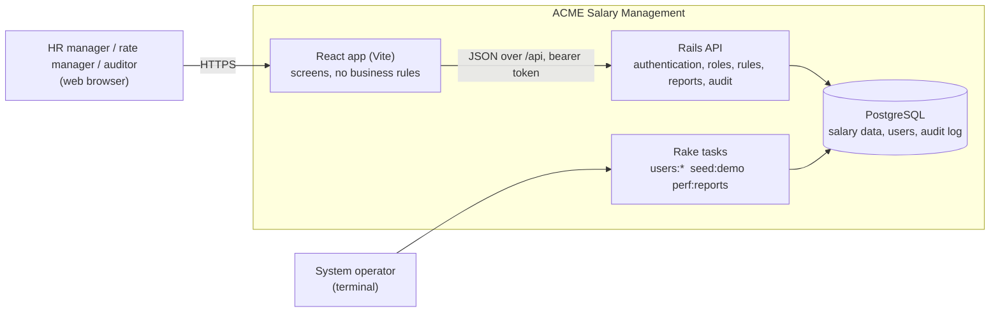
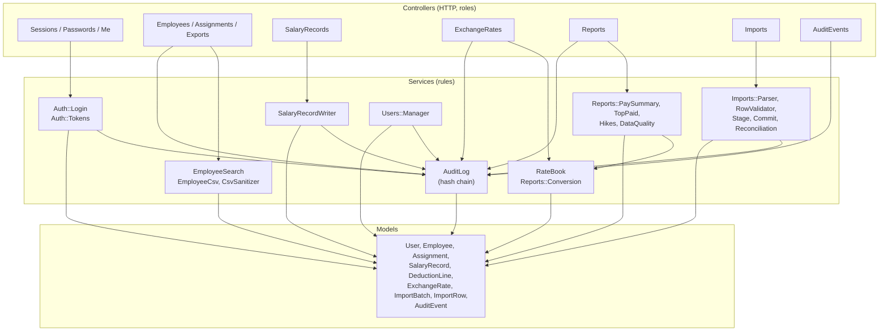
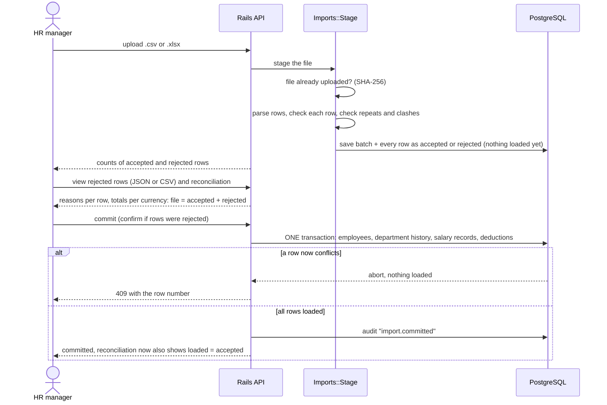
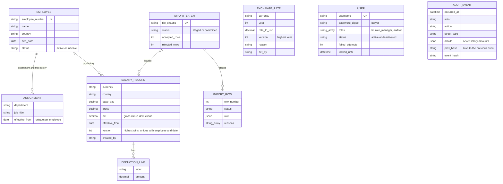

# Architecture

Diagrams are Mermaid, so GitHub draws them. They describe the code as built; `design.md` explains the reasoning and the trade-offs.

## 1. Containers

One Rails API, one PostgreSQL database, one React app. No queue, cache or search engine: at 10,000 employees they would add failure modes and nothing else.

Key points
- The browser only talks to the React app. In development Vite forwards `/api` to Rails, so there is one origin and no CORS setup.
- Operators manage accounts with rake tasks, not screens. Those actions are audited as `cli:<operator>`.
- Rails is the only thing that writes to the database, so every rule (net = gross - deductions, append-only history, audit) lives in one place.

## 2. Backend components

Controllers stay thin: check the role, call one service, audit, render. The rules sit in services and models.

Rules that every path obeys
- **Roles are checked on the server** in each controller (`require_role!`); hiding a tab in the UI is only a convenience.
- **Audit and action share one database transaction**, so there is never an action without its log line, or a log line for an action that rolled back.
- **Salary records and exchange rates are append-only.** A correction is a new version; `readonly?` blocks updates and deletes in the models.
- **Money is a decimal with a currency, never a float**, and is sent to the browser as a two-decimal string.

## 3. Excel migration

The import is two steps with a human in between, so bad data never reaches the live tables by accident.

## 4. Data model

`EXCHANGE_RATE`, `USER` and `AUDIT_EVENT` are standalone: rates are looked up by currency and year, and the audit log points at its target by type and id rather than by a foreign key, so it survives whatever happens to the target.

## Why this shape

- **Modular monolith, one database:** the work is correctness, security and migration quality, not scale. One transaction can cover an action, its audit entry and its data.
- **History as appended rows:** pay history and rate history are the product. Never editing a row makes "what did we pay in March" always answerable.
- **Thin UI:** the React app never decides a rule, so a second client or a script cannot bypass one.
